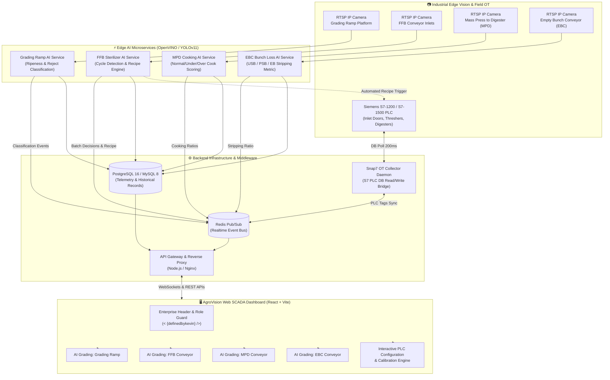

# AgroVision Industrial AI Grading & Web SCADA Suite

[](https://reactjs.org/)
[](https://vitejs.dev/)
[](https://nodejs.org/)
[](https://www.python.org/)
[](https://palletsprojects.com/p/flask/)
[](https://docs.ultralytics.com/)
[](https://software.intel.com/openvino)
[](http://snap7.sourceforge.net/)
[](https://www.docker.com/)
[](https://redis.io/)
[](https://www.postgresql.org/)
[](LICENSE)
[](https://github.com/definedbykevin)

**AgroVision** is an enterprise-grade industrial Computer Vision and Distributed Web SCADA suite built for large-scale Palm Oil Mills (Pabrik Minyak Kelapa Sawit - PMKS). The platform integrates deep-learning vision models (YOLOv11 / OpenVINO) operating at real-time edge CCTV camera feeds with Siemens S7 PLC telemetry, automated sterilizer recipe adjustments, supplier scorecard analytics, and interactive web-based Supervisory Control and Data Acquisition (SCADA) dashboards.

---

## 🔒 Confidentiality & White-Label Release Note (NDA Compliance)

> [!IMPORTANT]
> **Portfolio Preview Edition:**
> This repository is a sanitized, white-labeled standalone showcase derived from production industrial deployments. In strict compliance with Non-Disclosure Agreements (NDAs):
> 1. All proprietary client corporate identities, factory names, production database credentials, local mill IP addresses, and private RTSP CCTV URLs have been replaced with generic environment templates (`.env.example`).
> 2. The codebase features a built-in **Portfolio Preview & Telemetry Simulation State**. When edge hardware (RTSP camera streams or physical Siemens S7 PLCs) is not connected, the frontend dashboards automatically fall back to deterministic, realistic simulation datasets, donut distributions, throughput streams, and interactive control triggers without displaying offline errors or blank statistics.

---

## 🏗️ System Architecture

The following diagram illustrates the multi-tier distributed architecture spanning edge computer vision inference, operational technology (OT) PLC collectors, event-driven messaging, and the Web SCADA interface:



---

## 🌟 4 Core AI Grading Modules

### 1. AI Grading at Grading Ramp (Fruit Reception & Supplier Quality)
- **Objective:** Automated inbound Fresh Fruit Bunch (FFB) quality assessment directly at truck unloading reception platforms (Hoppers 1 to 4).
- **Classification Categories:**
  - `RIPE` *(Optimal OER potential, high oil content)*
  - `UNDERRIPE` *(Sub-optimal maturity)*
  - `UNRIPE / REJECT` *(Penalty trigger: <5% tolerance limit)*
  - `ROTTEN / REJECT` *(High Free Fatty Acid / FFA spike risk)*
  - `EMPTY BUNCH` *(Partially stripped bunches from plantation)*
- **Key Features:**
  - Automated License Plate Recognition (ALPR) supplier quality scorecard correlation.
  - Real-time batch rejection rate calculation with threshold enforcement.
  - Estimated Oil Extraction Rate (OER) predictive potential metrics.

### 2. AI Grading at FFB Conveyor (Sterilizer Station Infeed)
- **Objective:** High-speed inline bunch maturity profiling on feed conveyors before bunches enter sterilizer cages.
- **Workflow & PLC Synchronization:**
  - Synchronized with PLC inlet door sensors (`Line 1` to `Line 4`).
  - **Dynamic Recipe Recommendation Engine:** Automatically selects the optimal sterilizer cooking program (e.g. *3-Peak S-Curve Program* for hard/underripe batches vs. *Standard Program* for ripe batches) based on real-time bunch majority.
  - Interactive demonstration trigger allows toggling `INLET SIMULATION TRIGGER (DEMO)` across Lines 1–4 to immediately observe live state transitions between `DETECTION: IDLE` and `DETECTION: ACTIVE (LINE X)`.

### 3. AI Grading at Mass Press to Digester (MPD Conveyor)
- **Objective:** Continuously monitors the uniformity and cooking quality of sterilized loose fruit mash transported toward the press digester units.
- **Classification Categories:**
  - `NORMAL COOK` *(Optimal thermal penetration; cell walls ruptured for maximum oil release)*
  - `UNDER COOK` *(Hard kernels and fruit pulp; risks mechanical screw press wear and oil entrapment)*
  - `OVER COOK` *(Burnt mesocarp; degradation of carotene and elevation of peroxide value)*
- **Unit Standard:** Throughput telemetry expressed in **LF/m** (Loose Fruit per minute).
- **Operational Output:** Provides closed-loop feedback on optimal digester residence time and steam injection valves.

### 4. AI Grading at Empty Bunch Conveyor (EBC Discharge)
- **Objective:** Real-time post-threshing bunch loss inspection on the discharge conveyor carrying empty bunches to the incinerator/mulching plant.
- **Classification Categories:**
  - `EB` *(Empty Bunch: fully stripped stalk; optimal process efficiency)*
  - `PSB` *(Partially Stripped Bunch: moderate fruitlet residue remaining)*
  - `USB` *(Unstripped Bunch: high unthreshed bunch loss; mechanical alarm trigger)*
- **Unit Standard:** Throughput telemetry expressed in **EFB/m** (Empty Fruit Bunches per minute).
- **Process Optimization:** Monitors thresher drum rotational speed and automatic tippler cycle speeds to maintain bunch stripping efficiency >90%.

---

## 💻 Tech Stack

| Domain | Technologies & Libraries |
| :--- | :--- |
| **Frontend Web SCADA** | React 18, Vite, Three.js / React Three Fiber (3D Digital Twin), Leaflet, Canvas API |
| **Styling & Design** | Pure Modern CSS, Custom Industrial Dark/Light Themes, Flexbox/Grid, Responsive Layout |
| **Backend Microservices** | Node.js, Express, Python 3.10+, Flask, Socket.IO, RESTful APIs |
| **Computer Vision / AI** | YOLOv11 (Oriented Bounding Boxes - OBB), Intel OpenVINO Toolkit, OpenCV |
| **Industrial OT & Telemetry** | Siemens S7 Communication (`node-snap7` / `python-snap7`), OPC-UA Browser Client |
| **Data & Cache Layer** | PostgreSQL 16 (TimescaleDB / JSONB), MySQL 8.0, Redis (Pub/Sub Event Bus) |
| **DevOps & Orchestration** | Docker, Docker Compose, PM2 Process Manager, Nginx Reverse Proxy |

---

## 🚀 Getting Started (Local Development)

### Prerequisites
- [Node.js](https://nodejs.org/) (v18.x or v20.x recommended)
- [Python](https://www.python.org/) (v3.10 or higher)
- [Git](https://git-scm.com/)
- Optional: [Docker](https://www.docker.com/) & Docker Compose

### 1. Clone the Repository
```bash
git clone https://github.com/definedbykevin/agrovision-grading-scada.git
cd agrovision-grading-scada
```

### 2. Configure Environment Variables
Copy the root `.env.example` file to `.env`:
```bash
cp .env.example .env
```
*(The defaults are pre-configured for local development and portfolio preview mode).*

### 3. Running the Frontend Dashboard
Navigate to the frontend directory and install dependencies:
```bash
cd main-service/frontend
npm install
npm run dev
```
Open your browser at `http://localhost:5173` (or port indicated by Vite).

> [!TIP]
> **Explore Without Hardware:**
> When opening the web dashboard, the system operates in **Portfolio Preview Mode**. You can freely navigate through:
> - **Grading Ramp** $\rightarrow$ `AI GRADING - RAMP` tab to inspect recent detections, filter categories, and trigger simulated hopper grading.
> - **Sterilizer Station** $\rightarrow$ `AI GRADING - FFB` tab to interact with `INLET SIMULATION TRIGGER (DEMO)` (Line 1 to Line 4).
> - **Threshing Station** $\rightarrow$ `AI GRADING - MPD` & `AI GRADING - EBC` tabs to inspect live simulated CCTV inference feeds, donut charts, and throughput metrics.

### 4. Running Backend Microservices (Optional Full-Stack Mode)
To launch all services with PM2:
```bash
npm install -g pm2
pm2 start ecosystem.config.cjs
```
Or run with Docker Compose:
```bash
docker-compose -f docker-compose.yml up -d
```

---

## 📊 Default Port Allocation Table

| Service Name | Port | Description |
| :--- | :---: | :--- |
| **Frontend SCADA Shell** | `5173` / `5177` | Vite React Web SCADA Application |
| **Main Auth & Config** | `3001` | User sessions, station registry & permissions |
| **Realtime Service** | `3002` | WebSocket gateway & PLC live tag broadcaster |
| **Station Master Service**| `3003` | Inter-station telemetry coordination |
| **Sterilizer AI Service** | `4105` | FFB conveyor computer vision & recipe engine |
| **MPD AI Service** | `4106` | Mass Press to Digester cooking classifier |
| **EBC AI Service** | `4206` | Empty Bunch Conveyor unstripped bunch classifier |
| **PostgreSQL 16** | `5432` | Relational & time-series AI event persistence |
| **Redis Cache / Bus** | `6379` | Real-time Pub/Sub message broker |
| **MySQL 8.0** | `3306` | Legacy station relational records |

---

## 👨‍💻 Developer & Portfolio Attribution

Engineered and maintained by:

<p align="center">
  <a href="https://github.com/definedbykevin">
    
  </a>
</p>

- **GitHub Profile:** [@definedbykevin](https://github.com/definedbykevin)
- **Repository:** [agrovision-grading-scada](https://github.com/definedbykevin/agrovision-grading-scada)
- **Specialization:** Industrial AI Systems, SCADA Automation, Computer Vision Edge Deployment & High-Throughput Manufacturing Analytics.

---

## 📄 License
This portfolio version is provided under the [MIT License](LICENSE). Third-party dependencies and frameworks belong to their respective copyright holders.
