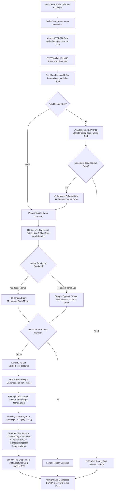

# DOKUMEN ARSITEKTUR, ALUR LOGIKA & KONSEP SISTEM
## DETEKSI & KLASIFIKASI TANDAN SAWIT (MULTI-CLASS) BERBASIS YOLO POLYGON SEGMENTATION & TRACKING

> **Catatan Dokumen**: Dokumen ini merupakan acuan teknis (*blueprint*) mengenai arsitektur, diagram alir, dan logika sistem computer vision untuk inspeksi tandan buah sawit pada conveyor. Sistem mengintegrasikan inferensi multi-kelas langsung dari model YOLO Segmentation dengan mekanisme pelacakan spasial Dual-ROI.

---

### DAFTAR ISI
1. [Ringkasan Eksekutif & Tujuan Sistem](#1-ringkasan-eksekutif--tujuan-sistem)
2. [Skema Kelas Deteksi Langsung Model YOLO (Multi-Class)](#2-skema-kelas-deteksi-langsung-model-yolo-multi-class)
3. [Sistem Koordinat Citra & Arah Aliran Conveyor](#3-sistem-koordinat-citra--arah-aliran-conveyor)
4. [Konsep Zonasi Spasial Ganda (Dual-ROI Mechanism)](#4-konsep-zonasi-spasial-ganda-dual-roi-mechanism)
   - 4.1. [Zona Hijau: Tracking ROI Zone (Sentuh Langsung Track)](#41-zona-hijau-tracking-roi-zone-sentuh-langsung-track)
   - 4.2. [Zona Merah: Trigger Scan Line (Garis Pemicu Eksekusi)](#42-zona-merah-trigger-scan-line-garis-pemicu-eksekusi)
5. [Logika Pemicuan Deteksi Ganda (Dual-Condition Trigger Scheme)](#5-logika-pemicuan-deteksi-ganda-dual-condition-trigger-scheme)
   - 5.1. [Kondisi 1: Normal (Titik Tengah Buah di Garis Merah)](#51-kondisi-1-normal-titik-tengah-buah-di-garis-merah)
   - 5.2. [Kondisi 2: Terhalang Conveyor / Scraper (Bagian Bawah di Garis Merah)](#52-kondisi-2-terhalang-conveyor--scraper-bagian-bawah-di-garis-merah)
   - 5.3. [Pencegahan Duplikasi (Anti-Double Capture Cache)](#53-pencegahan-duplikasi-anti-double-capture-cache)
6. [Logika Filter Spasial Tangkai (Stalk Containment Filtering)](#6-logika-filter-spasial-tangkai-stalk-containment-filtering)
   - 6.1. [Aturan Bisnis: Tidak Ada Tangkai Mandiri](#61-aturan-bisnis-tidak-ada-tangkai-mandiri)
   - 6.2. [Mekanisme Asosiasi Tangkai ke Tandan](#62-mekanisme-asosiasi-tangkai-ke-tandan)
7. [Masking Background Hijau Chroma (Studio Capture Isolation)](#7-masking-background-hijau-chroma-studio-capture-isolation)
   - 7.1. [Tujuan Isolasi Latar Belakang](#71-tujuan-isolasi-latar-belakang)
   - 7.2. [Standar Warna Chroma Green BGR(35, 255, 0)](#72-standar-warna-chroma-green-bgr35-255-0)
   - 7.3. [Formula Downstream Filtering](#73-formula-downstream-filtering)
8. [Format Citra Hasil Tangkapan (Inspection Snapshot Output)](#8-format-citra-hasil-tangkapan-inspection-snapshot-output)
9. [Diagram Alur Sistem End-to-End (Flowchart)](#9-diagram-alur-sistem-end-to-end-flowchart)
10. [Snippet Kode Inti Terintegrasi (Core Implementation Reference)](#10-snippet-kode-inti-terintegrasi-core-implementation-reference)
11. [Ringkasan Parameter Kalibrasi Rekomendasi](#11-ringkasan-parameter-kalibrasi-rekomendasi)

---

### 1. Ringkasan Eksekutif & Tujuan Sistem

Sistem ini dirancang untuk mendeteksi, mengklasifikasikan mutu kematangan, mensegmentasi tepi poligon (*polygon segmentation*), melacak pergerakan (*tracking*), dan mengambil tangkapan gambar (*snapshot*) tandan buah sawit secara *real-time* saat melintas di atas conveyor pabrik kelapa sawit.

Tantangan operasional di lapangan:
1. **Keberadaan Bilah Besi Conveyor (Scraper)**: Buah sering tertutup sebagian oleh scraper sehingga baru terdeteksi saat posisinya sudah melewati garis tengah.
2. **Sampah Tangkai / Debris Lepas**: Serat dan potongan tangkai lepas di conveyor sering menimbulkan *false positive* jika dideteksi secara terpisah.
3. **Latar Belakang Sabuk Conveyor Kotor**: Noda oli, kerak kotoran, dan karat besi mengganggu kualitas dokumentasi dan inspeksi visual.

Solusi arsitektur:
- **Deteksi Langsung Model YOLO Multi-Class**: Klasifikasi mutu kematangan (`ripe`, `underripe`, `overripe`) dan tangkai (`stalk`) dilakukan secara langsung dalam satu tahap inferensi jaringan saraf tiruan (YOLO Segmentation).
- **Zonasi Dual-ROI**: Memisahkan area pelacakan sensitif (kotak hijau) dengan garis eksekusi pemicu (garis merah).
- **Logika Dual-Trigger**: Menangani kondisi normal maupun kondisi buah terhalang conveyor.
- **Filter Tangkai Khusus**: Hanya mengakui tangkai yang menempel pada tandan buah sawit.
- **Isolasi Background Chroma Green**: Mengubah seluruh area di luar poligon buah menjadi hijau murni $\text{BGR}(35, 255, 0)$.

---

### 2. Skema Kelas Deteksi Langsung Model YOLO (Multi-Class)

Klasifikasi mutu tidak menggunakan algoritma pemrosesan warna berbasis aturan (*color thresholding*), melainkan **diprediksi secara langsung oleh model YOLO26-Seg** yang dilatih mengenali 4 kelas objek:

| Nama Kelas (*Class Label*) | Deskripsi Objek | Kategori Mutu Industri |
| :--- | :--- | :--- |
| `underripe` | Tandan buah kurang matang / mengkal / mentah, brondolan belum matang sempurna. | Fraksi 0 / Fraksi 00 (Penalti / peram) |
| `ripe` | Tandan buah matang sempurna, brondolan oranye kemerahan merata. | Fraksi 1 - 2 (Standar Mutu Utama Pabrik) |
| `overripe` | Tandan buah lewat matang, brondolan kusam atau rontok dari tandan. | Fraksi 3 - 4 (Asam Lemak Bebas / ALB tinggi) |
| `stalk` | Gagang / tangkai buah sawit yang menempel pada tandan. | Komponen struktural tandan |

```text
                                 ┌───────────────┐
                                 │   INPUT FRAME │
                                 │   DARI KAMERA │
                                 └───────┬───────┘
                                         │
                                         ▼
                 ┌────────────────────────────────────────────────┐
                 │          YOLO MULTI-CLASS SEGMENTATION         │
                 │   (Prediksi Bounding Box, Mask Poligon & Label)│
                 └───────┬───────────────┬────────────────┬───────┘
                         │               │                │
            ┌────────────┴───┐     ┌─────┴──────────┐     │
            │ KELAS TANDAN:  │     │ KELAS TANDAN:  │     │
            │ underripe      │     │ ripe /         │     │ KELAS STRUKTURAL:
            │                │     │ overripe       │     │ stalk
            └────────────┬───┘     └─────┬──────────┘     │
                         │               │                │
                         └───────┬───────┘                │
                                 │ (Tandan Buah)          │
                                 ▼                        ▼
                    ┌──────────────────────────────────────────┐
                    │      LOGIKA SPASIAL & FILTER TANGKAI     │
                    │  - Stalk mandiri -> DISCARD              │
                    │  - Stalk menempel -> Gabung ke Tandan    │
                    └──────────────────────────────────────────┘
```

**Keuntungan Deteksi Langsung via YOLO**:
- **Single-Pass Inference**: Deteksi posisi, batas poligon segmentasi, dan klasifikasi mutu selesai dalam satu kali inferensi model tanpa komputasi tambahan.
- **Robust Terhadap Variasi Cahaya**: Model berbasis deep learning lebih adaptif terhadap perubahan intensitas lampu pabrik, debu, dan sudut pandang kamera dibanding metode ambang warna manual.
- **Sederhana & Modular**: Pipeline kode program menjadi jauh lebih ringkas, mudah dipelihara, dan langsung kompatibel dengan bobot model (`.pt` / `.onnx` / `.engine`).

---

### 3. Sistem Koordinat Citra & Arah Aliran Conveyor

Pada sistem koordinat citra digital:
- Titik origin $(0, 0)$ berada di **Pojok Kiri-Atas**.
- Sumbu $X$ membentang horizontal dari kiri ke kanan ($0 \to W$).
- Sumbu $Y$ membentang vertikal dari atas ke bawah ($0 \to H$).

#### Arah Gerak Conveyor: DARI BAWAH KE ATAS ( $\Uparrow$ )
Buah sawit bergerak dari nilai ordinat $Y$ besar ($y \approx H$) menuju ordinat $Y$ kecil ($y \approx 0$).

```text
======================================================================
 Y = 0       [ AREA KELUAR / MENUJU STERILIZER / STASIUN REBUSAN ]
             ▲
             │ Arah Aliran Buah (Nilai Y Semakin Mengecil)
             │
----------------------------------------------------------------------
 Y = scan_y  ─── [ ZONA 2: RED TRIGGER SCAN LINE ] ─── (Garis Pemicu)
----------------------------------------------------------------------
             │
             │   ┌──────────────────────────────────────────────┐
             │   │                                              │
             │   │    ZONA 1: GREEN TRACKING ROI ZONE           │
             │   │    (Kotak Hijau Pelacak / Initial Lock)      │
             │   │                                              │
             │   └──────────────────────────────────────────────┘
 Y = roi_b   ────────────────────────────────────────────────────────
             ▲
             │ Arah Masuk Buah (Nilai Y Mendekati Tinggi Layar H)
 Y = H       [ AREA MASUK / LOADING CONVEYOR CONVEYOR INLET ]
======================================================================
```

---

### 4. Konsep Zonasi Spasial Ganda (Dual-ROI Mechanism)

Sistem membedakan secara tegas antara **Area Pelacakan (Tracking Zone)** dan **Garis Pemicu Eksekusi (Capture Trigger Line)**.

```text
        Y = 0
          │
          │
          ▼
   scan_line_y  ═══════════════════════════════════════════════ [ GARIS MERAH: Pemicu Eksekusi ]
                │                                             │
                │         KOTAK HIJAU TRACKING ROI            │
                │        (Sentuh Sedikit Langsung Track)       │
                │                                             │
   roi_bottom_y ─────────────────────────────────────────────── [ BATAS BAWAH KOTAK HIJAU ]
          ▲
          │
        Y = H   (Arah Masuk Buah dari Bawah)
```

#### 4.1. Zona Hijau: Tracking ROI Zone (Sentuh Langsung Track)
- **Bentuk & Posisi**: Kotak persegi panjang selebar conveyor ($X: 0 \to W$) yang terletak di bawah garis merah ($Y: scan\_line\_y \to scan\_line\_y + 220$).
- **Sifat Operasi**: **Sangat Sensitif**.
- **Logika**:
  - Begitu bagian terdepan ($y_1$) atau tepi poligon buah menyentuh sedikit saja area kotak hijau, algoritma pelacak (BYTETracker) langsung aktif.
  - Tracking ID unik (contoh: `TRK-105`) segera dikunci secara persisten (*continuous tracking*).
  - Memastikan kestabilan bounding box, poligon, dan kelas prediksi sebelum buah tiba di garis merah.

#### 4.2. Zona Merah: Trigger Scan Line (Garis Pemicu Eksekusi)
- **Bentuk & Posisi**: Garis horizontal lurus di posisi $Y = scan\_line\_y = \text{int}(H \times 0.65)$, berimpit dengan batas atas kotak hijau.
- **Sifat Operasi**: **Titik Eksekusi Foto (*Snapshot*)**.
- **Logika**:
  - Foto tidak diambil saat buah pertama kali menyentuh kotak hijau.
  - Foto dieksekusi tepat saat buah berada di garis merah sesuai kriteria pemicuan.

---

### 5. Logika Pemicuan Deteksi Ganda (Dual-Condition Trigger Scheme)

Pengambilan snapshot pada dasarnya terjadi saat **titik tengah buah berada tepat di garis merah**. Namun, untuk mengatasi kasus buah yang terhalang scraper sehingga telat terdeteksi, sistem menggunakan dua skema:

```text
 [ KONDISI 1: NORMAL ]                       [ KONDISI 2: TERHALANG CONVEYOR ]
 (Posisi buah tepat di tengah)               (Telat terdeteksi / scraper)

                                                                ┌───────────┐
                                                                │  Bagian   │
                                                                │   Atas    │
                                                                ├───────────┤
                                                                │ ● Tengah  │
        ┌───────────────┐                                     ┌──┤ (center_y)│
        │   Bagian      │                                     │  └───────────┘
        │    Atas       │                                     │  (Sudah lewat)
   ─────┼───────────────┼───── GARIS MERAH ─────────────── MERAH ─────────────
        │ ● Tengah      │                                     │  ┌───────────┐
        │  (center_y)   │                                     └──┤   Bawah   │
        ├───────────────┤                                        │   (y2)    │
        │   Bagian      │                                        └───────────┘
        │   Bawah (y2)  │                                        (Masih nyangkut)
        └───────────────┘
```

#### 5.1. Kondisi 1: Normal (Titik Tengah Buah di Garis Merah)
Kondisi standar saat buah tidak terhalang. Terpicu ketika koordinat vertikal titik tengah tandan ($center\_y = \frac{y_1 + y_2}{2}$) memotong garis merah dalam toleransi:
$$\left| center\_y - scan\_line\_y \right| < 18\text{ px}$$

#### 5.2. Kondisi 2: Terhalang Conveyor / Scraper (Bagian Bawah di Garis Merah)
Kondisi cadangan (*fail-safe*) saat buah terhalang bilah scraper sehingga baru terdeteksi ketika titik tengahnya sudah melampaui garis merah ($center\_y < scan\_line\_y$). Sistem tetap mengeksekusi capture selama bagian bawah tandan ($y_2$) masih menyentuh garis merah:
$$(y_1 \le scan\_line\_y \le y_2) \quad \land \quad (center\_y < scan\_line\_y) \quad \land \quad \left| y_2 - scan\_line\_y \right| < 30\text{ px}$$

#### 5.3. Pencegahan Duplikasi (Anti-Double Capture Cache)
Untuk memastikan 1 tandan buah fisik hanya difoto satu kali:
1. Sistem memeriksa set in-memory `tracked_ids_captured`.
2. Jika ID objek belum ada:
   - Snapshot diproses dan diekspor.
   - ID didaftarkan ke cache: `tracked_ids_captured.add(track_num)`.
3. Jika ID sudah terdaftar, frame berikutnya untuk objek yang sama otomatis diabaikan.

---

### 6. Logika Filter Spasial Tangkai (Stalk Containment Filtering)

#### 6.1. Aturan Bisnis: Tidak Ada Tangkai Mandiri
> **Kaidah Utama**: "Tangkai/stalk tidak boleh berdiri sendiri. Objek kelas `stalk` hanya diakui jika menempel atau tergabung dengan area tandan buah sawit (`ripe`, `underripe`, atau `overripe`)."

- Serpihan tangkai lepas, pelepah sawit, sampah conveyor, atau bayangan scraper yang terdeteksi sebagai `stalk` secara mandiri **dibuang 100% (*discarded*)**.
- Stalk mandiri tidak diberi ID pelacakan, tidak digambar poligonnya, dan tidak pernah memicu event capture.

#### 6.2. Mekanisme Asosiasi Tangkai ke Tandan
Untuk setiap deteksi $S \in \text{Stalk List}$ dan deteksi tandan buah $B \in \text{Bunch List}$ (`ripe`, `underripe`, `overripe`):
1. Dihitung bounding box tandan $(fx_1, fy_1, fx_2, fy_2)$ dan bounding box tangkai $(sx_1, sy_1, sx_2, sy_2)$ dengan titik tengah tangkai $(sc_x, sc_y)$.
2. **Kriteria Keterikatan Spasial**:
   - **Tumpang Tindih (*Intersection Area*)**:
     $$ix_1 = \max(fx_1, sx_1), \quad iy_1 = \max(fy_1, sy_1)$$
     $$ix_2 = \min(fx_2, sx_2), \quad iy_2 = \min(fy_2, sy_2)$$
     $$\text{InterArea} = \max(0, ix_2 - ix_1) \times \max(0, iy_2 - iy_1)$$
   - **Batas Toleransi Proksimitas ($\pm 35$ px)**:
     $$\text{InProximityZone} = (fx_1 - 35 \le sc_x \le fx_2 + 35) \land (fy_1 - 35 \le sc_y \le fy_2 + 35)$$
3. **Keputusan Asosiasi**:
   Jika $\text{InterArea} > 0$ atau $\text{InProximityZone} == \text{True}$:
   - Stalk diasosiasikan ke tandan buah sawit terdekat.
   - Poligon Stalk digabungkan ke poligon tandan buah sebagai satu kesatuan objek.
   - Metadata tandan diberi atribut tambahan: `has_stalk = True` (indikator `+STALK`).
   Jika tidak memenuhi kriteria pada tandan mana pun, stalk **dieliminasi dari frame**.

---

### 7. Masking Background Hijau Chroma (Studio Capture Isolation)

#### 7.1. Tujuan Isolasi Latar Belakang
Citra tangkapan layar mentah biasanya memuat sabuk conveyor hitam/kuning, bilah scraper, ceceran brondolan lepas, dan noda oli. Isolasi poligon membersihkan seluruh latar belakang sehingga menghasilkan foto buah bersih layaknya foto studio.

#### 7.2. Standar Warna Chroma Green BGR(35, 255, 0)
Saat capture terpicu:
1. Citra diambil dari frame murni kamera (`clean_frame`) tanpa teks atau garis overlay UI.
2. Dibuat masker biner dari gabungan poligon tandan dan poligon tangkai terkait:
   $$\text{PolyMask}(x, y) = \begin{cases} 255, & \text{jika } (x, y) \in \text{Poligon Tandan} \cup \text{Poligon Stalk} \\ 0, & \text{di luar poligon} \end{cases}$$
3. Dihitung bounding box gabungan ditambah margin padding aman sebesar 16 piksel.
4. Potongan citra (*crop*) diekstrak. Seluruh piksel di luar poligon ($\text{CropMask} == 0$) langsung diubah menjadi warna hijau solid:
   $$\text{Piksel Background} = \mathbf{BGR}(35, 255, 0)$$

#### 7.3. Formula Downstream Filtering
Sistem eksternal atau modul hilir dapat langsung memisahkan buah murni secara instan dengan satu baris perintah OpenCV:
```python
# Pemisahan latar belakang hijau chroma
mask_bg = cv2.inRange(img, np.array([25, 240, 0]), np.array([45, 255, 10]))

# Objek buah murni (foreground) adalah kebalikan dari mask_bg:
fruit_foreground = cv2.bitwise_not(mask_bg)
```

---

### 8. Format Citra Hasil Tangkapan (Inspection Snapshot Output)

Setiap buah yang terpicu disimpan sebagai **1 file citra inspeksi terpadu (All-in-One Composite Image berukuran 740 × 360 px)** yang menggabungkan citra fisik buah terisolasi dengan data hasil inferensi model YOLO dan grafik histogram gunung warna sebagai data visual tambahan:

```text
┌───────────────────────────────────────┬──────────────────────────────────────────────┐
│ PANEL KIRI (350 x 360 px)             │ PANEL KANAN (390 x 360 px)                   │
│                                       │                                              │
│  [ LATAR HIJAU CHROMA SOLID ]         │  FFB QUALITY INSPECTION REPORT               │
│  BGR(35, 255, 0)                      │  ------------------------------------------  │
│                                       │  TRK-105 | 10:15:30 AM | Conf: 94%           │
│               ████████                │                                              │
│             ██        ██              │  ┌────────────────────────┐                  │
│            ██  TANDAN  ██             │  │ KELAS MUTU: RIPE       │ (Prediksi YOLO)  │
│            ██  SAWIT   ██             │  └────────────────────────┘                  │
│            ██  MURNI   ██             │  Tangkai/Stalk: INCLUDE (+STALK)             │
│             ██        ██              │                                              │
│               ████████                │  [TELEMETRI WARNA - DATA TAMBAHAN]           │
│                                       │  Oranye Segar : 48.5%  |  Dasar Gelap: 16.2% │
│                                       │  Rasio Warna  : 2.99                         │
│                                       │                                              │
│                                       │  SPEKTRUM INTENSITAS WARNA (BENTUK GUNUNG)   │
│                                       │  ┌────────────────────────────────────────┐  │
│                                       │  │              ▲                         │  │
│                                       │  │     ▲       / \   Kurva Oranye Segar   │  │
│                                       │  │    / \ Kurva   \                       │  │
│                                       │  │  ─┘   \ Gelap   \───────────────────── │  │
│                                       │  └────────────────────────────────────────┘  │
│                                       │  ● Oranye Segar (48.5%)  ● Dasar Gelap (16.2%)│
└───────────────────────────────────────┴──────────────────────────────────────────────┘
```

#### Struktur & Peran Komponen Citra Komposit:
1. **Panel Kiri (Citra Fisik Buah Terisolasi - Chroma Green Background)**:
   - Menampilkan buah sawit murni hasil segmentasi poligon presisi.
   - Latar belakang di luar poligon diubah menjadi warna hijau solid $\text{BGR}(35, 255, 0)$, bebas dari interferensi sabuk conveyor atau scraper.
2. **Panel Kanan Atas (Hasil Prediksi Utama Model YOLO)**:
   - **Identitas & Stempel Waktu**: ID Pelacakan unik (`TRK-XXXXX`), waktu deteksi, dan skor keyakinan (*confidence*).
   - **Badge Mutu Kematangan Utama**: Ditentukan **secara langsung oleh model YOLO26-Seg** (`RIPE`, `UNDERRIPE`, `OVERRIPE`) dengan warna penanda kontras tinggi.
   - **Status Tangkai**: Menampilkan `INCLUDE (+STALK)` jika tangkai menempel pada tandan buah.
3. **Panel Kanan Bawah (Histogram Gunung Warna & Telemetri Tambahan)**:
   - **Peran & Fungsi**: Grafik spektrum bentuk gunung (*mountain-shaped distribution curve*) dan nilai persentase warna (**bukan sebagai acuan utama penentu kelas kematangan**), melainkan sebagai **data telemetri visual tambahan (*visual data enrichment / auxiliary data*)**.
   - **Visualisasi Gambar Tetap Menyatu**: Menggambarkan distribusi intensitas pigmen Oranye Segar dan Dasar Gelap dalam bentuk siluet lereng gunung topografi yang digambar langsung di atas kanvas citra inspeksi menggunakan OpenCV.
   - **Manfaat**: Operator atau tim laboratorium mutu pabrik dapat langsung melihat profil visual warna buah yang terdeteksi oleh YOLO secara komprehensif dalam satu file citra utuh.

**Karakteristik Output**:
- **Mandiri & Terpadu (*Self-Contained Single Image*)**: Seluruh informasi (foto buah terisolasi, hasil klasifikasi model YOLO, dan grafik histogram gunung warna) tersimpan menyatu dalam 1 file `.jpg` tanpa dependensi database eksternal.
- **Kualitas Tinggi**: Disimpan dalam format JPEG kualitas 98% (`static/captures/cap_<timestamp>.jpg`) untuk menjaga ketajaman garis poligon dan grafik.

---

### 9. Diagram Alur Sistem End-to-End (Flowchart)



---

### 10. Snippet Kode Inti Terintegrasi (Core Implementation Reference)

Berikut adalah implementasi Python ringkas yang menjalankan seluruh alur: inferensi multi-class YOLO, pelacakan spasial, filter tangkai, dual-condition trigger, masking background chroma green, serta pembuatan citra komposit lengkap dengan histogram spektrum gunung warna sebagai data visual tambahan:

```python
import os
import cv2
import numpy as np
from datetime import datetime

# Definisi 4 Kelas YOLO (3 Tandan Buah + 1 Stalk)
BUNCH_CLASSES = {"underripe", "ripe", "overripe"}
ALL_CLASSES = ["underripe", "ripe", "overripe", "stalk"]

def extract_color_telemetry(crop_img):
    """
    Mengekstrak data telemetri warna tambahan dari buah berlatar hijau chroma:
    Mengembalikan persentase Oranye Segar, Dasar Gelap, rasio, dan array intensitas.
    (Catatan: Nilai ini hanya sebagai data visual tambahan, bukan penentu kelas).
    """
    if crop_img is None or crop_img.size == 0:
        return 0.0, 0.0, 0.0, np.array([]), np.array([])

    mask_bg = cv2.inRange(crop_img, np.array([25, 240, 0]), np.array([45, 255, 10]))
    mask_tandan = cv2.bitwise_not(mask_bg)
    total_px = np.count_nonzero(mask_tandan)
    if total_px == 0:
        return 0.0, 0.0, 0.0, np.array([]), np.array([])

    hsv = cv2.cvtColor(crop_img, cv2.COLOR_BGR2HSV)
    H, S, V = hsv[:, :, 0], hsv[:, :, 1], hsv[:, :, 2]

    mask_gelap = (V < 65) & (mask_tandan == 255)
    mask_segar = (((H <= 22) | (H >= 168)) & (S >= 110) & (V >= 90)) & (mask_tandan == 255)

    p_gelap = (np.count_nonzero(mask_gelap) / total_px) * 100.0
    p_segar = (np.count_nonzero(mask_segar) / total_px) * 100.0
    rasio = p_segar / p_gelap if p_gelap > 0 else 99.0

    v_gelap = V[mask_gelap] if np.count_nonzero(mask_gelap) > 0 else np.array([])
    v_segar = V[mask_segar] if np.count_nonzero(mask_segar) > 0 else np.array([])

    return round(p_segar, 1), round(p_gelap, 1), round(rasio, 2), v_gelap, v_segar


def create_inspection_snapshot(crop_img, track_id, class_label, conf_val, has_stalk):
    """
    Menghasilkan 1 citra inspeksi terpadu (740x360 px):
    - Kiri : Tandan sawit hasil isolasi poligon di atas latar hijau chroma BGR(35, 255, 0).
    - Kanan: Laporan inspeksi (Prediksi Kelas YOLO, Metadata, serta Grafik
      Histogram Spektrum Warna Bentuk Gunung sebagai Data Visual Tambahan).
    """
    W_TOTAL, H_TOTAL = 740, 360
    W_LEFT = 350
    canvas = np.ones((H_TOTAL, W_TOTAL, 3), dtype=np.uint8) * 18

    # 1. Panel Kiri: Buah Latar Hijau Chroma
    left_box = np.zeros((H_TOTAL, W_LEFT, 3), dtype=np.uint8)
    left_box[:] = [35, 255, 0]
    if crop_img is not None and crop_img.size > 0:
        ch, cw, _ = crop_img.shape
        scale = min((W_LEFT - 20) / max(cw, 1), (H_TOTAL - 20) / max(ch, 1))
        nw, nh = max(1, int(cw * scale)), max(1, int(ch * scale))
        resized = cv2.resize(crop_img, (nw, nh), interpolation=cv2.INTER_AREA)
        ox, oy = (W_LEFT - nw) // 2, (H_TOTAL - nh) // 2
        left_box[oy:oy+nh, ox:ox+nw] = resized
    cv2.rectangle(left_box, (0, 0), (W_LEFT - 1, H_TOTAL - 1), (45, 52, 60), 2)
    canvas[:, :W_LEFT] = left_box

    # 2. Panel Kanan Atas: Laporan Prediksi YOLO
    rx = W_LEFT + 18
    cv2.putText(canvas, "FFB QUALITY INSPECTION REPORT", (rx, 30),
                cv2.FONT_HERSHEY_SIMPLEX, 0.52, (230, 230, 230), 2, cv2.LINE_AA)
    cv2.line(canvas, (rx, 38), (W_TOTAL - 16, 38), (55, 60, 70), 1)

    # Identitas & Stempel Waktu
    timestamp_str = datetime.now().strftime("%I:%M:%S %p")
    cv2.putText(canvas, f"{track_id} | {timestamp_str} | Conf: {int(conf_val * 100)}%",
                (rx, 55), cv2.FONT_HERSHEY_SIMPLEX, 0.40, (160, 165, 175), 1, cv2.LINE_AA)

    # Badge Mutu Utama (100% dari Model YOLO26-Seg)
    badge_colors = {
        "ripe": ((34, 197, 94), (0, 0, 0)),        # Hijau
        "underripe": ((0, 215, 255), (0, 0, 0)),   # Kuning
        "overripe": ((180, 80, 180), (255, 255, 255)) # Ungu
    }
    bg_col, txt_col = badge_colors.get(class_label.lower(), ((34, 197, 94), (0, 0, 0)))
    badge_text = f"KELAS MUTU: {class_label.upper()}"
    (bw, bh), _ = cv2.getTextSize(badge_text, cv2.FONT_HERSHEY_SIMPLEX, 0.55, 2)
    cv2.rectangle(canvas, (rx, 68), (rx + bw + 16, 68 + bh + 12), bg_col, -1)
    cv2.putText(canvas, badge_text, (rx + 8, 68 + bh + 6), cv2.FONT_HERSHEY_SIMPLEX, 0.55, txt_col, 2, cv2.LINE_AA)

    # Status Tangkai & Ekstraksi Data Tambahan Warna
    stalk_str = "INCLUDE (+STALK)" if has_stalk else "TIDAK ADA"
    cv2.putText(canvas, f"Tangkai/Stalk: {stalk_str}", (rx, 114),
                cv2.FONT_HERSHEY_SIMPLEX, 0.43, (210, 130, 240) if has_stalk else (120, 125, 135), 1, cv2.LINE_AA)

    p_segar, p_gelap, rasio, v_gelap, v_segar = extract_color_telemetry(crop_img)
    cv2.putText(canvas, f"Oranye Segar: {p_segar}% | Gelap: {p_gelap}% | Rasio: {rasio}",
                (rx, 133), cv2.FONT_HERSHEY_SIMPLEX, 0.40, (185, 190, 200), 1, cv2.LINE_AA)
    cv2.putText(canvas, "* Telemetri warna di bawah sebagai data tambahan visual, bukan acuan klasifikasi",
                (rx, 149), cv2.FONT_HERSHEY_SIMPLEX, 0.30, (110, 115, 125), 1, cv2.LINE_AA)

    # 3. Panel Kanan Bawah: Histogram Spektrum Warna Bentuk Gunung (Visualisasi Gambar Nyatu)
    gx, gy, gw, gh = rx, 162, W_TOTAL - rx - 16, 150
    cv2.rectangle(canvas, (gx, gy), (gx + gw, gy + gh), (26, 30, 36), -1)
    cv2.rectangle(canvas, (gx, gy), (gx + gw, gy + gh), (45, 52, 62), 1)
    cv2.putText(canvas, "SPEKTRUM INTENSITAS WARNA (BENTUK GUNUNG)", (gx + 8, gy + 14),
                cv2.FONT_HERSHEY_SIMPLEX, 0.35, (190, 195, 205), 1, cv2.LINE_AA)

    # Hitung 32 Bin Frekuensi
    num_bins = 32
    hist_g = np.zeros(num_bins, dtype=np.float32)
    hist_s = np.zeros(num_bins, dtype=np.float32)
    if len(v_gelap) > 0:
        hg, _ = np.histogram(v_gelap, bins=num_bins, range=(0, 255))
        hist_g = hg.astype(np.float32)
    if len(v_segar) > 0:
        hs, _ = np.histogram(v_segar, bins=num_bins, range=(0, 255))
        hist_s = hs.astype(np.float32)

    # Penghalusan Lereng Gunung (Gaussian 1D Filter)
    kernel = np.array([1, 2, 4, 2, 1], dtype=np.float32) / 10.0
    hist_g = np.convolve(hist_g, kernel, mode="same")
    hist_s = np.convolve(hist_s, kernel, mode="same")

    max_val = max(np.max(hist_g), np.max(hist_s), 1.0)
    plot_h = gh - 42
    base_y = gy + gh - 12

    pts_g, pts_s = [], []
    for i in range(num_bins):
        bx = int(gx + 10 + i * (gw - 20) / (num_bins - 1))
        pts_g.append([bx, int(base_y - (hist_g[i] / max_val) * plot_h)])
        pts_s.append([bx, int(base_y - (hist_s[i] / max_val) * plot_h)])

    # Gambar Siluet Gunung dengan Efek Transparansi (Alpha-Blending)
    hist_layer = canvas.copy()
    poly_g = np.array([[gx + 10, base_y]] + pts_g + [[gx + gw - 10, base_y]], np.int32)
    poly_s = np.array([[gx + 10, base_y]] + pts_s + [[gx + gw - 10, base_y]], np.int32)
    cv2.fillPoly(hist_layer, [poly_g], (65, 70, 80))
    cv2.fillPoly(hist_layer, [poly_s], (0, 115, 230))
    cv2.addWeighted(hist_layer, 0.55, canvas, 0.45, 0, canvas)

    # Garis Kontur Puncak Lereng Gunung
    cv2.polylines(canvas, [np.array(pts_g, np.int32)], False, (150, 155, 165), 2, cv2.LINE_AA)
    cv2.polylines(canvas, [np.array(pts_s, np.int32)], False, (0, 195, 255), 2, cv2.LINE_AA)

    # Legenda Titik Warna
    cv2.circle(canvas, (gx + 10, gy + gh + 14), 4, (0, 185, 255), -1)
    cv2.putText(canvas, f"Oranye Segar ({p_segar}%)", (gx + 18, gy + gh + 17),
                cv2.FONT_HERSHEY_SIMPLEX, 0.35, (0, 185, 255), 1, cv2.LINE_AA)
    cv2.circle(canvas, (gx + 175, gy + gh + 14), 4, (140, 145, 155), -1)
    cv2.putText(canvas, f"Dasar Gelap ({p_gelap}%)", (gx + 183, gy + gh + 17),
                cv2.FONT_HERSHEY_SIMPLEX, 0.35, (170, 175, 185), 1, cv2.LINE_AA)

    return canvas


def process_conveyor_yolo(frame, yolo_results, scan_line_y, tracked_captured_set, output_dir="static/captures"):
    """
    Memproses frame dengan model YOLO26-Seg multi-class segmentation:
    1. Parse kelas: ripe, underripe, overripe, stalk
    2. Filter stalk bebas & asosiasi stalk ke tandan terdekat
    3. Evaluasi Dual-Trigger & Chroma Green Masking
    """
    h, w, _ = frame.shape
    clean_frame = frame.copy()
    overlay = frame.copy()

    # Visualisasi ROI
    roi_bottom_y = min(h - 10, scan_line_y + 220)
    cv2.rectangle(overlay, (0, scan_line_y), (w, roi_bottom_y), (34, 197, 94), -1)
    cv2.line(frame, (0, scan_line_y), (w, scan_line_y), (0, 0, 255), 3)

    raw_bunches = []
    raw_stalks = []

    # 1. Parsing Deteksi YOLO26-Seg Multi-Class
    for r in yolo_results:
        if r.boxes is None: continue
        for i, box in enumerate(r.boxes):
            conf = float(box.conf[0].item())
            if conf < 0.45: continue

            cls_id = int(box.cls[0].item())
            cls_name = r.names.get(cls_id, "ripe").lower()
            track_id = int(box.id[0].item()) if box.id is not None else (100 + i)
            x1, y1, x2, y2 = map(int, box.xyxy[0].tolist())
            poly = r.masks.xy[i].astype(np.int32) if (r.masks and len(r.masks.xy) > i) else None

            det = {
                "id": track_id,
                "class": cls_name,
                "conf": conf,
                "bbox": (x1, y1, x2, y2),
                "poly": poly,
                "cx": (x1 + x2) // 2,
                "cy": (y1 + y2) // 2,
                "included_stalks": []
            }

            if cls_name == "stalk":
                raw_stalks.append(det)
            elif cls_name in BUNCH_CLASSES:
                raw_bunches.append(det)

    # 2. Filter Tangkai (Hanya diakui jika menempel pada tandan buah)
    for stk in raw_stalks:
        best_bunch, min_dist = None, float('inf')
        sx1, sy1, sx2, sy2 = stk['bbox']

        for bunch in raw_bunches:
            fx1, fy1, fx2, fy2 = bunch['bbox']
            inter_w = max(0, min(fx2, sx2) - max(fx1, sx1))
            inter_h = max(0, min(fy2, sy2) - max(fy1, sy1))
            in_zone = (fx1 - 35 <= stk['cx'] <= fx2 + 35) and (fy1 - 35 <= stk['cy'] <= fy2 + 35)

            if (inter_w * inter_h > 0) or in_zone:
                dist = np.hypot(stk['cx'] - bunch['cx'], stk['cy'] - bunch['cy'])
                if dist < min_dist:
                    min_dist = dist
                    best_bunch = bunch

        if best_bunch is not None:
            best_bunch['included_stalks'].append(stk)

    # 3. Evaluasi Trigger & Pengambilan Citra
    for bunch in raw_bunches:
        fx1, fy1, fx2, fy2 = bunch['bbox']
        track_num = bunch['id']
        cy = bunch['cy']
        cls_name = bunch['class']
        conf_val = bunch['conf']
        has_stalk = len(bunch['included_stalks']) > 0

        # Pemicuan Ganda (Normal & Terhalang Conveyor)
        cond_normal = abs(cy - scan_line_y) < 18
        cond_terhalang = (fy1 <= scan_line_y <= fy2) and (cy < scan_line_y) and (abs(fy2 - scan_line_y) < 30)

        if (cond_normal or cond_terhalang) and (track_num not in tracked_captured_set):
            tracked_captured_set.add(track_num)

            # Masking Poligon Gabungan (Tandan + Tangkai Terkait)
            poly_mask = np.zeros((h, w), dtype=np.uint8)
            if bunch['poly'] is not None:
                cv2.fillPoly(poly_mask, [bunch['poly']], 255)
            for stk in bunch['included_stalks']:
                if stk['poly'] is not None:
                    cv2.fillPoly(poly_mask, [stk['poly']], 255)

            all_x1 = [fx1] + [s['bbox'][0] for s in bunch['included_stalks']]
            all_y1 = [fy1] + [s['bbox'][1] for s in bunch['included_stalks']]
            all_x2 = [fx2] + [s['bbox'][2] for s in bunch['included_stalks']]
            all_y2 = [fy2] + [s['bbox'][3] for s in bunch['included_stalks']]

            pad = 16
            bx1, by1 = max(0, min(all_x1) - pad), max(0, min(all_y1) - pad)
            bx2, by2 = min(w, max(all_x2) + pad), min(h, max(all_y2) + pad)

            # Isolasi Chroma Green BGR(35, 255, 0)
            crop_img = clean_frame[by1:by2, bx1:bx2].copy()
            crop_mask = poly_mask[by1:by2, bx1:bx2]
            crop_img[crop_mask == 0] = [35, 255, 0]

            # Bentuk Snapshot Lengkap & Simpan
            snapshot = create_inspection_snapshot(
                crop_img=crop_img,
                track_id=f"TRK-{track_num}",
                class_label=cls_name,
                conf_val=conf_val,
                has_stalk=has_stalk
            )
            out_file = os.path.join(output_dir, f"cap_{track_num}_{cls_name}.jpg")
            cv2.imwrite(out_file, snapshot, [cv2.IMWRITE_JPEG_QUALITY, 98])
            print(f"[INSPEKSI] Objek TRK-{track_num} terverifikasi: {cls_name.upper()} (Conf: {int(conf_val*100)}%)")

    # Blend Visualisasi ROI
    cv2.addWeighted(overlay, 0.35, frame, 0.65, 0, frame)
    return frame
```

---

### 11. Ringkasan Parameter Kalibrasi Rekomendasi

| Parameter | Nilai Default | Kategori | Penjelasan & Panduan Penyetelan |
| :--- | :--- | :--- | :--- |
| `scan_line_y` | $\text{int}(H \times 0.65)$ | Spasial ROI | Posisi garis merah pemicu (65% dari atas layar). |
| `roi_bottom_y` | $scan\_line\_y + 220$ | Spasial ROI | Batas bawah kotak hijau tracking. Diperpanjang jika conveyor bergerak lebih cepat. |
| `cond_normal threshold` | $< 18\text{ px}$ | Pemicuan | Toleransi titik tengah tandan memotong garis merah pemicu. |
| `cond_terhalang threshold`| $< 30\text{ px}$ | Pemicuan | Toleransi sisa dasar buah ($y_2$) saat buah terhalang bilah scraper. |
| `stalk_proximity_margin` | $35\text{ px}$ | Filter Tangkai | Jarak toleransi maksimum tangkai terhadap tandan buah sawit. |
| `crop_padding` | $16\text{ px}$ | Masking | Margin aman antara batas terluar poligon dengan tepi potongan gambar. |
| `chroma_green` | `[35, 255, 0]` | Masking | Nilai warna BGR standar pengganti latar belakang di luar poligon. |
| `yolo_conf_threshold` | $0.45$ | Model AI | Nilai keyakinan minimum untuk menerima deteksi kelas YOLO. |
| `jpeg_quality` | $98$ | Penyimpanan | Kualitas kompresi citra ekspor agar tepi poligon tetap tajam dan presisi. |
